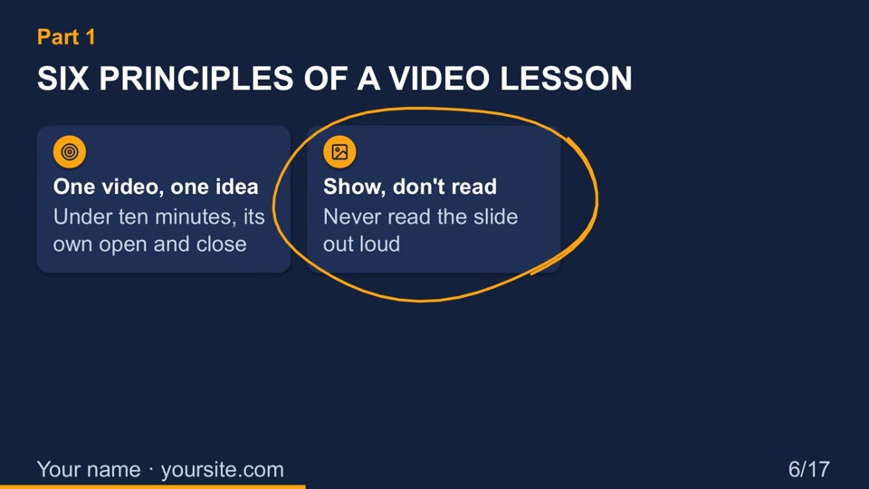
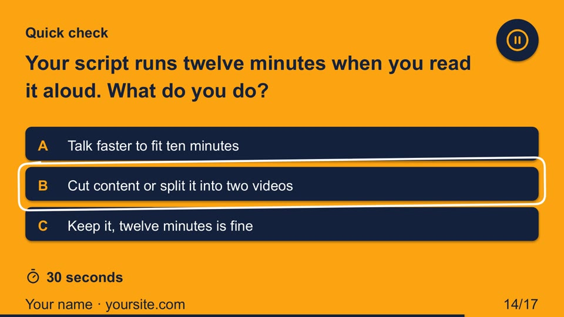

# Lesson Video Producer: a Claude Skill that turns lesson slides into a narrated, animated teaching video

**Lesson Video Producer is an open-source Agent Skill for Claude that turns a lesson slide deck into a finished 1080p lesson video: a local text-to-speech voice reads the narration, every card, step and table row appears exactly when the voice reaches it, transitions vary from slide to slide, key ideas get a hand-drawn circle, soft sound effects and a piano bed that ducks under the voice keep it lively, pause questions get a countdown, subtitles come as separate .vtt/.srt files, and real screen recordings slot into how-to lessons with smooth scrolling.**

You give Claude a deck made with [Lesson Slide Designer](https://github.com/chuonglife/lesson-slide-designer-skill): its `slides.json`, the `.pptx` and the slide images. An ordinary PowerPoint file on its own does not work, because the narration and the slide types live in `slides.json`; build the deck with that skill first. Claude reads the deck, builds a storyboard of what appears on which spoken line, generates the voice line by line, has Whisper listen back for mispronounced words, mixes the soundtrack, renders the picture frame by frame in headless Chrome, measures the result (loudness, frozen frames, jumpy scrolling) and looks at contact sheets before handing the video over. Change one slide and only that slide is rendered again.

It works in Claude Code, the Claude desktop app and the Claude Agent SDK. For self-paced online courses on Udemy, Teachable, Coursera, Thinkific, Kajabi or any LMS, corporate training and onboarding videos, flipped-classroom lectures and software tutorials. English and seven other languages with Kokoro, Vietnamese with VieNeu, both free and running on your own computer. MIT licensed.


It is the fourth skill in a set for course creators:
- [Curriculum Designer](https://github.com/chuonglife/curriculum-designer-skill) designs the whole program.
- [Lesson Content Writer](https://github.com/chuonglife/lesson-content-writer-skill) writes each lesson in full.
- [Lesson Slide Designer](https://github.com/chuonglife/lesson-slide-designer-skill) turns each lesson into slides and a narration script.
- **Lesson Video Producer** turns the slides into the finished video.
- [Lesson Assessment Designer](https://github.com/chuonglife/lesson-assessment-designer-skill) writes the quiz, test and assignment with a rubric for each lesson, straight from its objectives.

## Contents

- [What you get](#what-you-get)
- [Who it is for](#who-it-is-for)
- [Install](#install)
- [Use it](#use-it)
- [How the skill works](#how-the-skill-works)
- [What makes the video watchable](#what-makes-the-video-watchable)
- [Real screen recordings](#real-screen-recordings)
- [Fast re-renders](#fast-re-renders)
- [Example output](#example-output)
- [FAQ](#faq)
- [Repository layout](#repository-layout)
- [Sources and credits](#sources-and-credits)

## What you get

One folder per lesson:

| File | What it is |
|---|---|
| `<lesson>.mp4` | The video: 1920x1080, 30 fps, H.264 (yuv420p, limited range, BT.709), AAC 48 kHz, normalised to -16 LUFS |
| `<lesson>.en.vtt` / `.srt` | Subtitles as separate files (upload the .vtt as captions); never burned in, because slides are full of text |
| `<lesson>.storyboard.md` | A table of what happens when: regions per slide, the spoken line each one appears on, transitions, holds, circles |
| `<lesson>.voice.mp3` + `.timeline.json` | The narration and the exact start and end of every line |
| `_check/<lesson>.report.md` | Measurements: size, frame rate, loudness, true peak, silences, frozen frames, scroll jumps, effect density, with a PASS/FAIL verdict |
| `_check/contact-NN.png` | Three frames per slide (arriving, settled, about to leave) to review the whole video in a minute |
| `_check/voice-review.txt` | What Whisper heard differently from the script, with timestamps |
| `video.json` (optional) | Your overrides: reveal timing, transition, hold, circle, zoom, screen recording. Read from the video folder first, then from the folder of `slides.json`; clip paths inside it are relative to the folder it is in |

## Who it is for

- **Online course creators and Udemy instructors** who record slide-based lectures and want a professional narrated video without recording their voice or learning an editor.
- **Teachers and lecturers** making flipped-classroom videos or lesson recaps.
- **Corporate trainers and L&D teams** producing onboarding, product and compliance videos at scale.
- **Instructional designers** who want videos that respect multimedia learning principles out of the box.
- **Software trainers and coaches** who mix slides with real screen recordings.
- Anyone who wants **AI-narrated explainer videos** that do not look like a slideshow with a robot reading it.

## Install

**This skill needs a deck from the [Lesson Slide Designer](https://github.com/chuonglife/lesson-slide-designer-skill) skill.** It renders `slides.json` + `<name>.pptx` + `_preview/slide-NN.png`, the three things that skill writes. Install that skill too, unless you only want to render the example deck that ships in this repository (see [Try it](#try-it-on-the-example-deck)).

### Before you start

Install these once. The skill runs them on your own computer, in Claude Code.

| What | Why | Windows (PowerShell) | macOS (Homebrew) | Debian, Ubuntu |
|---|---|---|---|---|
| **Python 3.10, 3.11 or 3.12** | all scripts. Kokoro does not install on 3.13 or newer (`kokoro` declares `<3.13`), so pick 3.12 | `winget install Python.Python.3.12` | `brew install python@3.12` | `sudo apt install python3.12 python3.12-venv` |
| **Node.js 18 or newer**, with npm | the frame renderer | `winget install OpenJS.NodeJS.LTS` | `brew install node` | `sudo apt install nodejs npm` |
| **ffmpeg and ffprobe** on your PATH | audio, video, checks | `winget install Gyan.FFmpeg` | `brew install ffmpeg` | `sudo apt install ffmpeg` |
| **Chrome, Chromium or Edge** | renders the frames (headless) | Edge is already there | `brew install --cask google-chrome` | `sudo apt install chromium` |
| **git** | to clone | `winget install Git.Git` | comes with Xcode tools | `sudo apt install git` |
| **Lesson Slide Designer** skill | makes the deck this skill renders: `slides.json`, the `.pptx`, `_preview/slide-NN.png` | see [its README](https://github.com/chuonglife/lesson-slide-designer-skill#install) | same | same |
| **LibreOffice and Poppler** | the slide skill uses them to turn the `.pptx` into the `_preview` images. Here they are also used to show a .docx, .pdf or .pptx inside a long take | `winget install TheDocumentFoundation.LibreOffice` and `winget install oschwartz10612.Poppler` | `brew install --cask libreoffice` and `brew install poppler` | `sudo apt install libreoffice poppler-utils` |
| **About 6 GB free** | 1.5 GB of Python libraries (torch is most of it), the Whisper model 3.1 GB, the voice model 0.3 to 0.6 GB, plus your videos | | | |

If your distribution has no `python3.12` package or an old Node, use [python.org](https://www.python.org/downloads/) or pyenv, and [nodejs.org](https://nodejs.org). Open a new terminal after installing so the new PATH is picked up, then check with `python --version`, `node --version` and `ffmpeg -version`. If your default `python` is 3.13 or newer, create the environment below with `py -3.12` (Windows) or `python3.12` instead.

A GPU is optional: it makes the voice and Whisper several times faster. On a CPU everything works, with one caveat about Whisper below.

**The first video downloads the models, and prints nothing while it does.** Sizes measured from the model repositories:

| Model | Size | When |
|---|---|---|
| Whisper large-v3 (the voice review) | 3.1 GB | step 3 of the first video |
| Kokoro-82M | 330 MB, plus a 13 MB spaCy English model that Kokoro installs into the `.venv` by itself | the first English line |
| VieNeu-TTS v3 Turbo | 580 MB | the first Vietnamese line |

On a shared home connection the first Kokoro line took 17 minutes and the first VieNeu line 10 minutes in our test; later runs start in seconds. Whisper large-v3 on a CPU needs several GB of free memory and is slow; on a machine without an NVIDIA GPU or with less than 16 GB of RAM set `WHISPER_MODEL=medium` (see [Whisper settings](#whisper-settings)).

**Plan for about 25 minutes.** Measured on a Windows 11 laptop: `requirements.txt` took 318 s, `kokoro soundfile` 915 s (it pulls torch, and pip stays silent for minutes while it downloads; it has not hung), `npm install` 37 s. The virtual environment ends up at 1.5 GB.

### Pick the voice engine

The voice is not in `requirements.txt`: install the engine for the language of your lessons, into the same `.venv` (the commands below do it), or into its own environment (see [Voice engine in its own environment](#voice-engine-in-its-own-environment)).

| Lessons in | Engine | Install into the `.venv` | Notes |
|---|---|---|---|
| English (US and UK), Spanish, French, Hindi, Italian, Brazilian Portuguese | [Kokoro-82M](https://github.com/hexgrad/kokoro) | `pip install kokoro soundfile` | Python 3.10 to 3.12 only. Pulls torch, about 1 GB and 15 minutes. espeak-ng comes inside the pip package, nothing else to install |
| Mandarin | Kokoro-82M | `pip install kokoro soundfile "misaki[zh]"` | The extra adds the Chinese text front end (pure Python) |
| Japanese | Kokoro-82M | `pip install kokoro soundfile "misaki[ja]"` | The extra builds `pyopenjtalk` from source. On Windows that needs Visual Studio Build Tools with the "Desktop development with C++" workload first (`winget install Microsoft.VisualStudio.2022.BuildTools`); without a compiler the install fails with a CMake error. We have not run Japanese on Windows ourselves |
| Vietnamese | [VieNeu-TTS](https://github.com/pnnbao97/VieNeu-TTS) v3 Turbo | `pip install vieneu soundfile` | Runs on the CPU without torch (ONNX Runtime). About 800 MB and 9 minutes (measured on Windows 11). For an NVIDIA GPU see its README (CUDA torch first on Windows) |
| Any language, your own voice | none | nothing | Record one file per narration line and use `--engine files` (see the [FAQ](#can-i-use-my-own-recorded-voice)) |

Both engines are free, Apache 2.0 and run offline after the first download of the model. You only need the one you use. The voice follows `"language"` in `slides.json`: `en` am_michael, `es` ef_dora, `fr` ff_siwis, `hi` hf_alpha, `it` if_sara, `ja` jf_alpha, `pt` pf_dora, `zh` zf_xiaobei, `vi` VieNeu "Hải Đăng". `--voice <name>` picks another one. A language outside this list stops the run with a message, because no local voice reads it; use `--engine files` with your own recordings.

**Forgot something?** Nothing breaks. Before step 1, `make_video.py` checks everything the run needs: `node`, `ffmpeg`, `ffprobe`, a browser, the renderer's `node_modules`, the Python libraries, and the voice engine in the Python it will use (with the Japanese or Mandarin extra when the deck needs it). For each missing item it prints the name, the install command for Windows, macOS and Linux, and a reminder to open a new terminal. If it finds the voice in a `.venv` of the current folder or of the skill folder, it tells you to run with that Python. Claude reads that message and can finish the setup with you.

### Claude Code, one project only (recommended)

The skill sits in your course project and its Python libraries go into a `.venv` in the same project, so nothing touches the rest of your machine. Run these from the project folder.

macOS or Linux (bash):

```bash
git clone https://github.com/chuonglife/lesson-video-producer-skill .claude/skills/lesson-video-producer
python3.12 -m venv .venv
.venv/bin/python -m pip install -r .claude/skills/lesson-video-producer/requirements.txt
.venv/bin/python -m pip install kokoro soundfile      # English and 7 other languages; slow, see above
# .venv/bin/python -m pip install vieneu soundfile    # Vietnamese instead (or as well)
npm install --prefix .claude/skills/lesson-video-producer/assets/engine   # the frame renderer (puppeteer-core)
```

Windows (PowerShell):

```powershell
git clone https://github.com/chuonglife/lesson-video-producer-skill .claude\skills\lesson-video-producer
py -3.12 -m venv .venv
.\.venv\Scripts\python.exe -m pip install -r .claude\skills\lesson-video-producer\requirements.txt
.\.venv\Scripts\python.exe -m pip install kokoro soundfile      # English and 7 other languages
# .\.venv\Scripts\python.exe -m pip install vieneu soundfile    # Vietnamese instead (or as well)
npm install --prefix .claude\skills\lesson-video-producer\assets\engine
```

For Mandarin or Japanese add the extra from the table above to the Kokoro line. On Windows, `requirements.txt` also installs `pywin32` and `comtypes`, which the recorders `record_screen.py` and `record_actions.py` need. Claude uses the project's `.venv` on its own (the skill tells it to); you do not have to activate it.

### Claude Code, personal (all projects)

macOS or Linux (bash):

```bash
git clone https://github.com/chuonglife/lesson-video-producer-skill ~/.claude/skills/lesson-video-producer
cd ~/.claude/skills/lesson-video-producer
python3.12 -m venv .venv
.venv/bin/python -m pip install -r requirements.txt
.venv/bin/python -m pip install kokoro soundfile      # or: vieneu soundfile for Vietnamese
cd assets/engine
npm install
```

Windows (PowerShell):

```powershell
git clone https://github.com/chuonglife/lesson-video-producer-skill "$HOME\.claude\skills\lesson-video-producer"
py -3.12 -m venv "$HOME\.claude\skills\lesson-video-producer\.venv"
& "$HOME\.claude\skills\lesson-video-producer\.venv\Scripts\python.exe" -m pip install -r "$HOME\.claude\skills\lesson-video-producer\requirements.txt"
& "$HOME\.claude\skills\lesson-video-producer\.venv\Scripts\python.exe" -m pip install kokoro soundfile   # or: vieneu soundfile for Vietnamese
npm install --prefix "$HOME\.claude\skills\lesson-video-producer\assets\engine"
```

Here the environment lives inside the skill folder, so tell Claude once which Python to use, for example "run the video scripts with `~/.claude/skills/lesson-video-producer/.venv` Python", or put that line in your project's `CLAUDE.md`.

### Claude desktop app

Use the **Code tab** of the desktop app (it is Claude Code) and install as above. The chat tab is not supported: a skill uploaded under Settings, Capabilities, Skills runs in a remote sandbox, not on your computer, so it cannot use the browser, ffmpeg, the Python environment or the voice models you installed here. The `lesson-video-producer.skill` file on the [releases page](https://github.com/chuonglife/lesson-video-producer-skill/releases/latest) is the skill folder as a zip (SKILL.md, scripts, references, assets, templates; the example deck is only in the repository), for people who prefer a download to `git clone`: unzip it into `.claude/skills/` and continue with the `venv`, `pip` and `npm` lines above.

### Voice engine in its own environment

If Kokoro or VieNeu lives in a separate virtual environment, point the skill at that Python. bash:

```bash
export KOKORO_PYTHON=/path/to/kokoro-env/bin/python
export VIENEU_PYTHON=/path/to/vieneu-env/bin/python
```

PowerShell:

```powershell
$env:KOKORO_PYTHON = "C:\path\to\kokoro-env\Scripts\python.exe"
$env:VIENEU_PYTHON = "C:\path\to\vieneu-env\Scripts\python.exe"
```

To keep it for every new terminal on Windows, use `setx KOKORO_PYTHON "C:\path\to\kokoro-env\Scripts\python.exe"` (then open a new terminal).

Set `CHROME_PATH` the same way if Chrome, Chromium or Edge is not found. The skill runs on Windows, macOS and Linux; only the recorders `record_screen.py` and `record_actions.py` are Windows-only (use OBS or ffmpeg elsewhere).

### Whisper settings

Step 3 has Whisper listen to the voice and compare it with the script. Three environment variables change how, set like `KOKORO_PYTHON` above:

| Variable | Default | Use it when |
|---|---|---|
| `WHISPER_MODEL` | `large-v3` (3.1 GB) | The machine has no NVIDIA GPU or less than 16 GB of RAM: `medium` (1.5 GB) is the lighter choice; expect a few more words flagged that the voice read correctly, and add those to the exceptions file after listening. `small` (0.5 GB) is for testing the pipeline only: small models mishear more and can invent whole sentences, so real errors hide among false ones. Vietnamese: stay on `large-v3`, the tone check depends on it |
| `WHISPER_DEVICE` | `cuda` when CTranslate2 sees a GPU, else `cpu` | `cpu` when the GPU is busy with something else or its CUDA libraries fail to load |
| `CUDA_DLL_DIRS` | empty | Windows, GPU: extra folders with the cuBLAS and cuDNN DLLs, separated by `;`, when they are not in the PyTorch or `nvidia-*` pip packages of the environment |

PowerShell: `$env:WHISPER_MODEL = "medium"`; bash: `export WHISPER_MODEL=medium`. The review prints `loading Whisper <model> on <device>` when it starts, so you can see which one runs.

### Check the install

```bash
.venv/bin/python .claude/skills/lesson-video-producer/scripts/preflight.py
.venv/bin/python .claude/skills/lesson-video-producer/scripts/make_video.py --help
```

On Windows: `.\.venv\Scripts\python.exe .claude\skills\lesson-video-producer\scripts\preflight.py`, then the same with `make_video.py --help`. The first prints where it found `node`, `ffmpeg`, `ffprobe` and the browser, or how to install the one that is missing. The second should print the options without an error.

Then check the voice you installed (it should print `voice OK`):

```bash
.venv/bin/python -c "import kokoro, soundfile; print('voice OK')"     # Vietnamese: import vieneu, soundfile
```

On Windows: `.\.venv\Scripts\python.exe -c "import kokoro, soundfile; print('voice OK')"`. `No module named 'kokoro'` means it went into another Python: install it again with the `.venv` Python shown above, never with a bare `pip`.

### Try it on the example deck

The repository ships one complete deck (`slides.json`, the `.pptx`, 17 slide images), so you can render a video before you have a deck of your own. From the project folder:

```bash
.venv/bin/python .claude/skills/lesson-video-producer/scripts/make_video.py .claude/skills/lesson-video-producer/examples/M04-L02-script-a-video-lesson/slides.json
```

```powershell
.\.venv\Scripts\python.exe .claude\skills\lesson-video-producer\scripts\make_video.py .claude\skills\lesson-video-producer\examples\M04-L02-script-a-video-lesson\slides.json
```

The video (about 4 min 45 s) lands in `examples/M04-L02-script-a-video-lesson/video/`, with the report and contact sheets in `video/_check/`. The first run downloads the models listed above; add `--skip-review` to try the pipeline without the 3.1 GB Whisper download (never for a video you publish). The example's `video.json` (a zoom on slide 13) is read from the folder of `slides.json`.

Your own decks come from [Lesson Slide Designer](https://github.com/chuonglife/lesson-slide-designer-skill): `slides.json`, the `.pptx` and the `_preview/slide-NN.png` images, in `slides/<course>/<lesson>/`. The video goes to `videos/<course>/<lesson>/`.

### If something stops

- **"... was not found on the PATH"**: a program is missing or the terminal is older than the install. Run the command in the message, open a new terminal, run again.
- **"The kokoro voice is not installed in this Python"**: the command ran with another Python than the `.venv`. The message names the right one.
- **Nothing is printed for minutes at step 2 or 3**: a model is downloading (see the sizes above).
- **"[gpu_lock] waiting: GPU busy with ..."**: voice and Whisper jobs run one at a time through a lock file, `~/.gpu-lock/gpu.lock`, shared by every project on the machine. Another render holds it. `python scripts/gpu_lock.py --show` says who; if that job is gone, `python scripts/gpu_lock.py --release`.
- **Step 3 runs out of memory or takes very long on a CPU**: `WHISPER_MODEL=medium`.
- **"RECORDING REFUSED"** from `record_actions.py`: `comtypes` is missing, so private text on screen could not be masked. `pip install comtypes` into the `.venv`.

## Use it

Ask in plain language. The skill triggers on requests to make, render or export a lesson video, a course video, a narrated slideshow or a voice-over for slides. The deck must come from Lesson Slide Designer; if you only have a PowerPoint or a lesson text, ask Claude to build the deck with that skill first.

```
Make the video for slides/support-onboarding/M03-L02/slides.json.
Female voice, no background music.
```

```
Turn the deck in slides/udemy-course/M02-L01 into the final video. Question on slide 9 should wait 20 seconds,
circle answer C after the wait, and zoom on the third step of slide 12.
```

```
Lesson 4 teaches how to build a rubric in Google Sheets. Record the browser window while you do it,
put the recording on slide 7 and make the video.
```

```
I changed the wording on slide 5. Re-render the video.
```

## How the skill works

1. **Read the deck and settle the brief**: language and voice, which slides pause, what to circle or zoom, whether the lesson needs real screen recordings.
2. **Storyboard** (`storyboard.py`): measures every shape in the `.pptx`, groups shapes into regions (a card, a step, a table row), and decides on which narration line each region appears, with which effect, transition and sound. Writes a table you can review before rendering.
3. **Voice** (`make_voice.py`): one line at a time with Kokoro or VieNeu, natural pauses (longer after questions and before a turn, shorter inside a list), cached by line.
4. **Whisper review** (`review_voice.py`): transcribes the voice and compares it with the script; suspect lines are regenerated and re-checked, up to three rounds, and anything still wrong stops the run with timestamps.
5. **Sound** (`mix_audio.py`): voice, effects locked to the on-screen actions, and a piano bed ducked under the voice.
6. **Picture** (`render.mjs` + `video.js`): headless Chrome renders every frame as a pure function of time, one segment per slide.
7. **Screen recordings** (`composite_clips.py`), **subtitles** (`make_subtitles.py`) and **the final check** (`check_video.py`).
8. **Look**: Claude reads the contact sheets and the report, fixes what is off, and only then hands the video over.

One command runs steps 2 to 7: `python scripts/make_video.py slides/<course>/<lesson>/slides.json`.

## What makes the video watchable

Built on the instructional standard for video learning materials (one topic per video, a script, opening-presentation-closing, spoken transitions, interaction) and on Mayer's multimedia principles:

- **The picture arrives before the voice, never after.** A slide settles 0.4 s before its first line, each card appears on the first sentence that mentions it and finishes 0.3 s early, steps and table rows keep their order, and `check_video.py` measures all of it. In English lessons a small teaching pointer moves to the idea being explained (switch it off with `"_all": {"cursor": false}`).
- **Things appear when the voice says them** (temporal contiguity, signalling). Cards pop in one by one, steps slide up, compare columns come in from their own side, table rows arrive row by row.
- **Something changes every 5 to 10 seconds**, and nothing stands still for more than 25: reveals, attention circles, gentle zooms and a very slow Ken Burns push on long slides.
- **One focal point per frame.** No spins, flips or flying letters; text never moves while it is being read.
- **Transitions that mean something**: a zoom-blur for a new part, an iris for a question, varied pushes and wipes elsewhere, never the same twice in a row.
- **Hand-drawn attention circles**: the answer after a pause question, and any idea the narration stresses ("remember", "never", "the key point"), drawn on and faded.
- **Sound you feel more than hear**: original synthesised marimba notes, pops and swooshes 19 to 23 dB under the voice, at most 16 a minute, and a quiet piano bed (-28 dB) that ducks whenever the voice speaks.
- **Pauses that agree with the screen**: "pause the video" narration holds briefly (the learner presses pause), other questions get a visible countdown.
- **Subtitles as separate files** so they never cover the slide text.

## Real screen recordings

Lessons that teach an action show the real action. **Recording from a script is the default**: you (or Claude) write what should happen in an action script, and `record_actions.py` plays it in a Windows Terminal window while it records. It types like a person, presses keys, waits until Claude Code (or any program) is done and answers its prompts, waits for a result file on jobs that take an hour, scrolls through the answer at reading speed, opens the files the job wrote, masks emails, API keys and user paths while they are on screen, and stops by itself. Nobody has to sit at the keyboard, and the take can be repeated exactly. It never types into the wrong window: if the recorded window cannot be brought to the front, or the command it started is not found, it stops instead. `close_recording_windows.py` clears windows left from an earlier take. The masking reads the terminal text through UI Automation (the `comtypes` package, in `requirements.txt`); when that is not available the script refuses to record, and only `"scan_private": false` in the action script turns the scan off. Both recorders need Windows 10 or 11 and ffmpeg 8.1 or newer (the `gfxcapture` filter); `winget install Gyan.FFmpeg` gives a current one.

Recording by hand is the fallback. `record_screen.py` records one window (even when covered), scrolls it smoothly with small wheel steps, and checks the result. `check_motion.py` measures jumpy scrolling, which a still image never shows; `smooth_scroll.py` replays each jump as a smooth scroll. `composite_clips.py` places the recording inside the slide's frame (or full screen), fades it in over its own first frame, keeps it between 0.8x and 1.25x speed, and `--extend` adds silence when a recording runs longer than its narration.

For long how-to lessons that are mostly screen recording there is a long-take mode: `long_take.py` turns the recording into an action table to write the narration from, then cuts or fast-forwards the waits, zooms into the text, highlights clicks and keys and lays each piece of narration on its own piece of picture. After each result it can show the real artifact (the document, the deck, the video the job made), built from the file itself with an "Opening: <file>" label, so learners see the work and not only "Done" in a terminal. See SKILL.md step 2b.

## Fast re-renders

Each slide is rendered to its own segment, named by a hash of everything that affects it (the slide image, its storyboard entry, its narration timing, the previous slide, the renderer). Fix one slide and only that segment is rendered again; the segments are joined without re-encoding. In the example (a 4 min 45 s lesson, 17 slides), the first render took 110 s of rendering; adding a zoom to one slide re-rendered 1 of 17 segments in 28 s, and the whole command, checks included, ran in 75 s. The voice is cached line by line in the same way, so editing one narration line regenerates one line.

## Example output

A 17-slide lesson for teachers and trainers, "Design and script a video lesson" (the example deck of Lesson Slide Designer), rendered by the skill with the Kokoro voice `am_michael`: 4 min 45 s, -16.3 LUFS, 64 sound effects, 0 scroll jumps, Whisper review clean. One override in `video.json` adds a zoom on slide 13. [examples/M04-L02-script-a-video-lesson](examples/M04-L02-script-a-video-lesson)

- [The video (mp4, 42 MB)](https://github.com/chuonglife/lesson-video-producer-skill/releases/download/v1.0.0/example-lesson-video.mp4), attached to release v1.0.0
- [Storyboard](examples/M04-L02-script-a-video-lesson/M04-L02-script-a-video-lesson.storyboard.md), [check report](examples/M04-L02-script-a-video-lesson/M04-L02-script-a-video-lesson.report.md), [voice review](examples/M04-L02-script-a-video-lesson/voice-review.txt), [subtitles](examples/M04-L02-script-a-video-lesson/M04-L02-script-a-video-lesson.en.vtt)
- The input, complete, so you can render it yourself ([Try it](#try-it-on-the-example-deck)): [slides.json](examples/M04-L02-script-a-video-lesson/slides.json), the `.pptx`, the 17 images in `_preview/` and the overrides [video.json](examples/M04-L02-script-a-video-lesson/video.json). The outputs listed above are from the v1.0.0 render

| Cards with an attention circle | Pause question, answer circled |
|---|---|
|  |  |

## FAQ

### What is a Claude Skill?

A Claude Skill (Agent Skill) is a folder with a `SKILL.md` file, reference documents and scripts. Claude loads it when a request matches its description, then follows its instructions and runs its scripts. Skills run in Claude Code, the Claude apps and the Claude Agent SDK.

### How is this different from exporting PowerPoint as a video?

PowerPoint's export plays slides one after another with recorded narration or fixed timings. This skill reveals each element in sync with a synthetic voice, varies transitions, circles key ideas, adds a ducked soundtrack and countdowns, checks the pronunciation with Whisper, measures loudness and motion, and re-renders only what changed. You also never record your own voice.

### Which text-to-speech voices does it use, and can I sell the videos?

Kokoro-82M (English, Spanish, French, Hindi, Italian, Japanese, Brazilian Portuguese, Mandarin; Japanese and Mandarin need one extra pip package, see [Pick the voice engine](#pick-the-voice-engine)) and VieNeu-TTS (Vietnamese). Both are open models under the Apache 2.0 license and run locally, so there is no per-minute cost. Check each platform's rules on disclosing AI voices (Udemy asks for a line in the course description).

### Does it need a GPU or a paid service?

No paid service at all. A GPU speeds up the voice and Whisper. On a CPU the voice and the picture are fine (a 58 s test video: 45 s of picture rendering); the slow part is the Whisper review with the default `large-v3` model, so set `WHISPER_MODEL=medium` there (see [Whisper settings](#whisper-settings)).

### What if Kokoro is not installed?

Nothing is lost. Before it does any work, `make_video.py` checks that the voice engine can be loaded. If it cannot, it stops and prints the fix for your machine: the `.venv` that already has the voice if there is one next to your project or in the skill folder, otherwise the `pip install kokoro soundfile` command with full paths, a warning when that Python is 3.13 or newer (Kokoro needs 3.10 to 3.12), and how to point it at another environment with `KOKORO_PYTHON`. The same check covers `node`, `ffmpeg`, `ffprobe`, the browser and the Python libraries. Claude reads that message and can set up the environment with you. If you cannot install it, use your own recordings (next question).

### Can I use my own recorded voice?

Yes. Record one file per line of `<lesson>.narration.txt` (`001.wav`, `002.wav`, ...) and run `make_video.py ... --engine files --voice <that folder>`. The skill adds the pauses, the timing, the reveals and the soundtrack exactly as with a synthetic voice.

### How long can a video be, and what about Udemy's requirements?

The renderer has no limit; the standard it follows recommends 5 to 12 minutes per topic video. The output meets Udemy's specs (1080p, H.264/AAC, consistent loudness, WebVTT captions); a deck split into topic videos is rendered one video at a time.

### Can it add screen recordings to slides?

Yes. On Windows, write an action script and let `record_actions.py` record it (the default), or record by hand with the included recorder or any tool; smooth the scrolling and declare the clip on a slide in `video.json`.

### Is it free?

Yes. MIT license. The sound effects and the piano bed were synthesised in code for this project and are covered by the same license.

## Repository layout

```
SKILL.md                              instructions Claude follows
references/video-standards.md         the instructional standard for video, mapped to slide types
references/motion-and-sound.md        regions, effects, transitions, circles, soundtrack, video.json
references/narration-voice.md         Kokoro, VieNeu, pronunciation fixes, the Whisper review
references/screen-recording.md        recording, smooth scrolling, compositing, privacy
references/quality-checks.md          thresholds and the contact-sheet checklist
scripts/make_video.py                 the one command: preflight -> storyboard -> voice -> review -> mix -> render -> check
scripts/preflight.py                  checks node, ffmpeg, ffprobe and the browser; the install message for each
scripts/storyboard.py                 slides.json + pptx -> storyboard.json / .md, narration.txt
scripts/make_voice.py                 narration.txt -> voice.mp3 + timeline.json (Kokoro, VieNeu)
scripts/review_voice.py               Whisper check of the voice
scripts/mix_audio.py                  voice + effects + ducked music
scripts/composite_clips.py            screen recordings into the video
scripts/make_subtitles.py             .srt and .vtt from the timeline
scripts/check_video.py                measurements, report, contact sheets
scripts/check_motion.py               jumpy-scroll detector
scripts/smooth_scroll.py              smooths jumpy scrolling in a recording
scripts/record_screen.py              window recorder with smooth scrolling (Windows)
scripts/record_actions.py             records a terminal session from an action script (Windows)
scripts/close_recording_windows.py    closes recording windows left from an earlier take, tab by tab (Windows)
scripts/long_take.py                  long-take mode: action table, cut/fast-forward waits, zoom, click and key highlights
scripts/insert_artifacts.py           shows the real document, deck, image or video after a result in a long take
scripts/gpu_lock.py                   one GPU job at a time
scripts/make_sfx.py, make_music.py    regenerate the original sounds and the piano bed
assets/engine/                        video.html, video.js (the frame renderer), render.mjs (Chrome + ffmpeg)
assets/sfx/, assets/music/            the synthesised sound effects and piano bed
assets/whisper-homophones-en.txt      words Whisper spells differently, accepted in every English voice review
templates/video.example.json          per-slide overrides
examples/                             an example lesson: the complete deck to render, and the outputs of a render
CHANGELOG.md                          what changed in each release
```

## Sources and credits

- Nguyen Minh Khanh, *Developing digital learning materials: audio and video* (Phát triển học liệu số dạng audio, video), Institute of Technical Education, Ho Chi Minh City University of Technology and Education. The standard: forms, interactions, design principles and structure of a video lesson.
- Mayer, R. E. (2009), *Multimedia Learning* (2nd ed.), Cambridge University Press.
- Guo, P. J., Kim, J., and Rubin, R. (2014), "How video production affects student engagement: An empirical study of MOOC videos", Proceedings of the First ACM Conference on Learning @ Scale.
- Motion timing and easing from the motion design rules of [claude-motion](https://github.com/whaleyxbt/claude-motion) (MIT).
- [Kokoro-82M](https://huggingface.co/hexgrad/Kokoro-82M) (Apache 2.0), VieNeu-TTS (Apache 2.0), [faster-whisper](https://github.com/SYSTRAN/faster-whisper) (MIT), [Puppeteer](https://pptr.dev) (Apache 2.0), [FFmpeg](https://ffmpeg.org).

The skill was first written in Vietnamese by Chuong for his own production line of online courses for teachers and trainers, refined on real lessons that were rendered, listened to and reviewed, then generalised and translated for public use.

## Contributing

Issues and pull requests are welcome, especially new transitions and effects, recorders for macOS and Linux, and pronunciation notes for other languages.

## License

[MIT](LICENSE)
