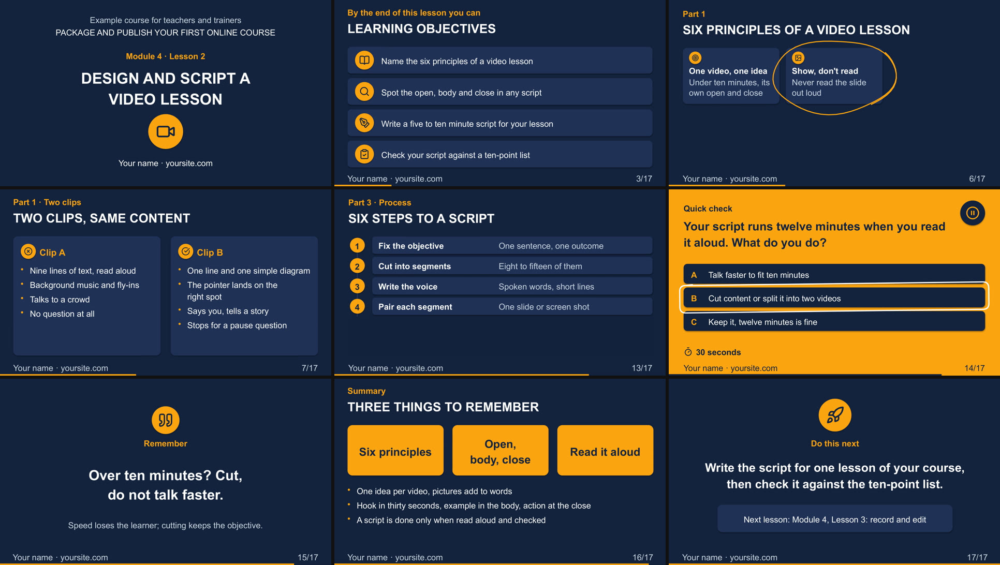

# Lesson Video Producer: a Claude Skill that turns lesson slides into a narrated, animated teaching video

**Lesson Video Producer is an open-source Agent Skill for Claude that turns a lesson slide deck into a finished 1080p lesson video: a local text-to-speech voice reads the narration, every card, step and table row appears exactly when the voice reaches it, transitions vary from slide to slide, key ideas get a hand-drawn circle, soft sound effects and a piano bed that ducks under the voice keep it lively, pause questions get a countdown, subtitles come as separate .vtt/.srt files, and real screen recordings slot into how-to lessons with smooth scrolling.**

You give Claude a slide deck. Claude reads the deck, builds a storyboard of what appears on which spoken line, generates the voice line by line, has Whisper listen back for mispronounced words, mixes the soundtrack, renders the picture frame by frame in headless Chrome, measures the result (loudness, frozen frames, jumpy scrolling) and looks at contact sheets before handing the video over. Change one slide and only that slide is rendered again.

It works in Claude Code, the Claude desktop app and the Claude Agent SDK. For self-paced online courses on Udemy, Teachable, Coursera, Thinkific, Kajabi or any LMS, corporate training and onboarding videos, flipped-classroom lectures and software tutorials. English and eight other languages with Kokoro, Vietnamese with VieNeu, both free and running on your own computer. MIT licensed.



It is the fourth skill in a set for course creators:
- [Curriculum Designer](https://github.com/chuonglife/curriculum-designer-skill) designs the whole program.
- [Lesson Content Writer](https://github.com/chuonglife/lesson-content-writer-skill) writes each lesson in full.
- [Lesson Slide Designer](https://github.com/chuonglife/lesson-slide-designer-skill) turns each lesson into slides and a narration script.
- **Lesson Video Producer** turns the slides into the finished video.
- [Lesson Assessment Designer](https://github.com/chuonglife/lesson-assessment-designer-skill) writes the quiz, test and assignment with a rubric for each lesson, straight from its objectives.

## Contents

- [What you get](#what-you-get)
- [Who it is for](#who-it-is-for)
- [Install](#install)
- [Use it](#use-it)
- [How the skill works](#how-the-skill-works)
- [What makes the video watchable](#what-makes-the-video-watchable)
- [Real screen recordings](#real-screen-recordings)
- [Fast re-renders](#fast-re-renders)
- [Example output](#example-output)
- [FAQ](#faq)
- [Repository layout](#repository-layout)
- [Sources and credits](#sources-and-credits)

## What you get

One folder per lesson:

| File | What it is |
|---|---|
| `<lesson>.mp4` | The video: 1920x1080, 30 fps, H.264, AAC 48 kHz, normalised to -16 LUFS |
| `<lesson>.en.vtt` / `.srt` | Subtitles as separate files (upload the .vtt as captions); never burned in, because slides are full of text |
| `<lesson>.storyboard.md` | A table of what happens when: regions per slide, the spoken line each one appears on, transitions, holds, circles |
| `<lesson>.voice.mp3` + `.timeline.json` | The narration and the exact start and end of every line |
| `_check/<lesson>.report.md` | Measurements: size, frame rate, loudness, true peak, silences, frozen frames, scroll jumps, effect density, with a PASS/FAIL verdict |
| `_check/contact-NN.png` | Three frames per slide (arriving, settled, about to leave) to review the whole video in a minute |
| `_check/voice-review.txt` | What Whisper heard differently from the script, with timestamps |
| `video.json` (optional) | Your overrides: reveal timing, transition, hold, circle, zoom, screen recording |

## Who it is for

- **Online course creators and Udemy instructors** who record slide-based lectures and want a professional narrated video without recording their voice or learning an editor.
- **Teachers and lecturers** making flipped-classroom videos or lesson recaps.
- **Corporate trainers and L&D teams** producing onboarding, product and compliance videos at scale.
- **Instructional designers** who want videos that respect multimedia learning principles out of the box.
- **Software trainers and coaches** who mix slides with real screen recordings.
- Anyone who wants **AI-narrated explainer videos** that do not look like a slideshow with a robot reading it.

## Install

**Claude Code (personal, all projects)**

```bash
git clone https://github.com/chuonglife/lesson-video-producer-skill ~/.claude/skills/lesson-video-producer
cd ~/.claude/skills/lesson-video-producer
pip install -r requirements.txt
pip install kokoro soundfile          # the English voice (or install it in its own environment, see below)
cd assets/engine && npm install       # the frame renderer (puppeteer-core)
```

**Claude Code (one project only)**: clone into `.claude/skills/lesson-video-producer` instead and run the same installs.

**Claude desktop app**: download `lesson-video-producer.skill` from the [latest release](https://github.com/chuonglife/lesson-video-producer-skill/releases/latest), add it under Settings, Capabilities, Skills, and install the requirements above on the same machine (the skill runs local programs).

**Requirements**: Python 3.10+, Node.js 18+, `ffmpeg` and `ffprobe`, and Chrome, Chromium or Edge (set `CHROME_PATH` if it is not found). A GPU makes the voice and Whisper faster but is not required. Windows, macOS and Linux; the window recorder `record_screen.py` is Windows-only (use OBS or ffmpeg elsewhere). If the voice engine lives in its own virtual environment, point the skill at it:

```bash
export KOKORO_PYTHON=/path/to/kokoro-env/bin/python
```

The slides come from [Lesson Slide Designer](https://github.com/chuonglife/lesson-slide-designer-skill): `slides.json`, the `.pptx` and the `_preview/slide-NN.png` images.

## Use it

Ask in plain language. The skill triggers on requests to make, render or export a lesson video, a course video, a narrated slideshow or a voice-over for slides.

```
Make the video for slides/support-onboarding/M03-L02/slides.json.
Female voice, no background music.
```

```
Turn my Udemy lecture deck into the final video. Question on slide 9 should wait 20 seconds,
circle answer C after the wait, and zoom on the third step of slide 12.
```

```
Lesson 4 teaches how to build a rubric in Google Sheets. Record the browser window while you do it,
put the recording on slide 7 and make the video.
```

```
I changed the wording on slide 5. Re-render the video.
```

## How the skill works

1. **Read the deck and settle the brief**: language and voice, which slides pause, what to circle or zoom, whether the lesson needs real screen recordings.
2. **Storyboard** (`storyboard.py`): measures every shape in the `.pptx`, groups shapes into regions (a card, a step, a table row), and decides on which narration line each region appears, with which effect, transition and sound. Writes a table you can review before rendering.
3. **Voice** (`make_voice.py`): one line at a time with Kokoro or VieNeu, natural pauses (longer after questions and before a turn, shorter inside a list), cached by line.
4. **Whisper review** (`review_voice.py`): transcribes the voice and compares it with the script; suspect lines are regenerated and re-checked, up to three rounds, and anything still wrong stops the run with timestamps.
5. **Sound** (`mix_audio.py`): voice, effects locked to the on-screen actions, and a piano bed ducked under the voice.
6. **Picture** (`render.mjs` + `video.js`): headless Chrome renders every frame as a pure function of time, one segment per slide.
7. **Screen recordings** (`composite_clips.py`), **subtitles** (`make_subtitles.py`) and **the final check** (`check_video.py`).
8. **Look**: Claude reads the contact sheets and the report, fixes what is off, and only then hands the video over.

One command runs steps 2 to 7: `python scripts/make_video.py slides/<course>/<lesson>/slides.json`.

## What makes the video watchable

Built on the instructional standard for video learning materials (one topic per video, a script, opening-presentation-closing, spoken transitions, interaction) and on Mayer's multimedia principles:

- **Things appear when the voice says them** (temporal contiguity, signalling). Cards pop in one by one, steps slide up, compare columns come in from their own side, table rows arrive row by row.
- **Something changes every 5 to 10 seconds**, and nothing stands still for more than 25: reveals, attention circles, gentle zooms and a very slow Ken Burns push on long slides.
- **One focal point per frame.** No spins, flips or flying letters; text never moves while it is being read.
- **Transitions that mean something**: a zoom-blur for a new part, an iris for a question, varied pushes and wipes elsewhere, never the same twice in a row.
- **Hand-drawn attention circles**: the answer after a pause question, and any idea the narration stresses ("remember", "never", "the key point"), drawn on and faded.
- **Sound you feel more than hear**: original synthesised marimba notes, pops and swooshes 19 to 23 dB under the voice, at most 16 a minute, and a piano bed that ducks whenever the voice speaks.
- **Pauses that agree with the screen**: "pause the video" narration holds briefly (the learner presses pause), other questions get a visible countdown.
- **Subtitles as separate files** so they never cover the slide text.

## Real screen recordings

Lessons that teach an action show the real action. `record_screen.py` records one window (even when covered), scrolls it smoothly with small wheel steps, and checks the result. `check_motion.py` measures jumpy scrolling, which a still image never shows; `smooth_scroll.py` replays each jump as a smooth scroll. `composite_clips.py` places the recording inside the slide's frame (or full screen), fades it in over its own first frame, keeps it between 0.8x and 1.25x speed, and `--extend` adds silence when a recording runs longer than its narration.

## Fast re-renders

Each slide is rendered to its own segment, named by a hash of everything that affects it (the slide image, its storyboard entry, its narration timing, the previous slide, the renderer). Fix one slide and only that segment is rendered again; the segments are joined without re-encoding. In the example (a 4 min 45 s lesson, 17 slides), the first render took 110 s of rendering; adding a zoom to one slide re-rendered 1 of 17 segments in 28 s, and the whole command, checks included, ran in 75 s. The voice is cached line by line in the same way, so editing one narration line regenerates one line.

## Example output

A 17-slide lesson for teachers and trainers, "Design and script a video lesson" (the example deck of Lesson Slide Designer), rendered by the skill with the Kokoro voice `am_michael`: 4 min 45 s, -16.3 LUFS, 64 sound effects, 0 scroll jumps, Whisper review clean. One override in `video.json` adds a zoom on slide 13. [examples/M04-L02-script-a-video-lesson](examples/M04-L02-script-a-video-lesson)

- [The video (mp4)](https://github.com/chuonglife/lesson-video-producer-skill/releases/latest), attached to the latest release
- [Storyboard](examples/M04-L02-script-a-video-lesson/M04-L02-script-a-video-lesson.storyboard.md), [check report](examples/M04-L02-script-a-video-lesson/M04-L02-script-a-video-lesson.report.md), [voice review](examples/M04-L02-script-a-video-lesson/voice-review.txt), [subtitles](examples/M04-L02-script-a-video-lesson/M04-L02-script-a-video-lesson.en.vtt)
- The input: [slides.json](examples/M04-L02-script-a-video-lesson/slides.json) and the overrides [video.json](examples/M04-L02-script-a-video-lesson/video.json)

| Cards with an attention circle | Pause question, answer circled |
|---|---|
|  |  |

## FAQ

### What is a Claude Skill?

A Claude Skill (Agent Skill) is a folder with a `SKILL.md` file, reference documents and scripts. Claude loads it when a request matches its description, then follows its instructions and runs its scripts. Skills run in Claude Code, the Claude apps and the Claude Agent SDK.

### How is this different from exporting PowerPoint as a video?

PowerPoint's export plays slides one after another with recorded narration or fixed timings. This skill reveals each element in sync with a synthetic voice, varies transitions, circles key ideas, adds a ducked soundtrack and countdowns, checks the pronunciation with Whisper, measures loudness and motion, and re-renders only what changed. You also never record your own voice.

### Which text-to-speech voices does it use, and can I sell the videos?

Kokoro-82M (English, Spanish, French, Hindi, Italian, Japanese, Brazilian Portuguese, Mandarin) and VieNeu-TTS (Vietnamese). Both are open models under the Apache 2.0 license and run locally, so there is no per-minute cost. Check each platform's rules on disclosing AI voices (Udemy asks for a line in the course description).

### Does it need a GPU or a paid service?

No paid service at all. A GPU speeds up the voice and Whisper; on a CPU a 5-minute lesson still renders in reasonable time.

### Can I use my own recorded voice?

Yes. Record one file per line of `<lesson>.narration.txt` (`001.wav`, `002.wav`, ...) and run `make_video.py ... --engine files --voice <that folder>`. The skill adds the pauses, the timing, the reveals and the soundtrack exactly as with a synthetic voice.

### How long can a video be, and what about Udemy's requirements?

The renderer has no limit; the standard it follows recommends 5 to 12 minutes per topic video. The output meets Udemy's specs (1080p, H.264/AAC, consistent loudness, WebVTT captions); a deck split into topic videos is rendered one video at a time.

### Can it add screen recordings to slides?

Yes. Record with the included Windows recorder or any tool, smooth the scrolling, and declare the clip on a slide in `video.json`.

### Is it free?

Yes. MIT license. The sound effects and the piano bed were synthesised in code for this project and are covered by the same license.

## Repository layout

```
SKILL.md                              instructions Claude follows
references/video-standards.md         the instructional standard for video, mapped to slide types
references/motion-and-sound.md        regions, effects, transitions, circles, soundtrack, video.json
references/narration-voice.md         Kokoro, VieNeu, pronunciation fixes, the Whisper review
references/screen-recording.md        recording, smooth scrolling, compositing, privacy
references/quality-checks.md          thresholds and the contact-sheet checklist
scripts/make_video.py                 the one command: storyboard -> voice -> review -> mix -> render -> check
scripts/storyboard.py                 slides.json + pptx -> storyboard.json / .md, narration.txt
scripts/make_voice.py                 narration.txt -> voice.mp3 + timeline.json (Kokoro, VieNeu)
scripts/review_voice.py               Whisper check of the voice
scripts/mix_audio.py                  voice + effects + ducked music
scripts/composite_clips.py            screen recordings into the video
scripts/make_subtitles.py             .srt and .vtt from the timeline
scripts/check_video.py                measurements, report, contact sheets
scripts/check_motion.py               jumpy-scroll detector
scripts/smooth_scroll.py              smooths jumpy scrolling in a recording
scripts/record_screen.py              window recorder with smooth scrolling (Windows)
scripts/gpu_lock.py                   one GPU job at a time
scripts/make_sfx.py, make_music.py    regenerate the original sounds and the piano bed
assets/engine/                        video.html, video.js (the frame renderer), render.mjs (Chrome + ffmpeg)
assets/sfx/, assets/music/            the synthesised sound effects and piano bed
templates/video.example.json          per-slide overrides
examples/                             a rendered example lesson
```

## Sources and credits

- Nguyen Minh Khanh, *Developing digital learning materials: audio and video* (Phát triển học liệu số dạng audio, video), Institute of Technical Education, Ho Chi Minh City University of Technology and Education. The standard: forms, interactions, design principles and structure of a video lesson.
- Mayer, R. E. (2009), *Multimedia Learning* (2nd ed.), Cambridge University Press.
- Guo, P. J., Kim, J., and Rubin, R. (2014), "How video production affects student engagement: An empirical study of MOOC videos", Proceedings of the First ACM Conference on Learning @ Scale.
- Motion timing and easing from the motion design rules of [claude-motion](https://github.com/whaleyxbt/claude-motion) (MIT).
- [Kokoro-82M](https://huggingface.co/hexgrad/Kokoro-82M) (Apache 2.0), VieNeu-TTS (Apache 2.0), [faster-whisper](https://github.com/SYSTRAN/faster-whisper) (MIT), [Puppeteer](https://pptr.dev) (Apache 2.0), [FFmpeg](https://ffmpeg.org).

The skill was first written in Vietnamese by Chuong for his own production line of online courses for teachers and trainers, refined on real lessons that were rendered, listened to and reviewed, then generalised and translated for public use.

## Contributing

Issues and pull requests are welcome, especially new transitions and effects, recorders for macOS and Linux, and pronunciation notes for other languages.

## License

[MIT](LICENSE)
